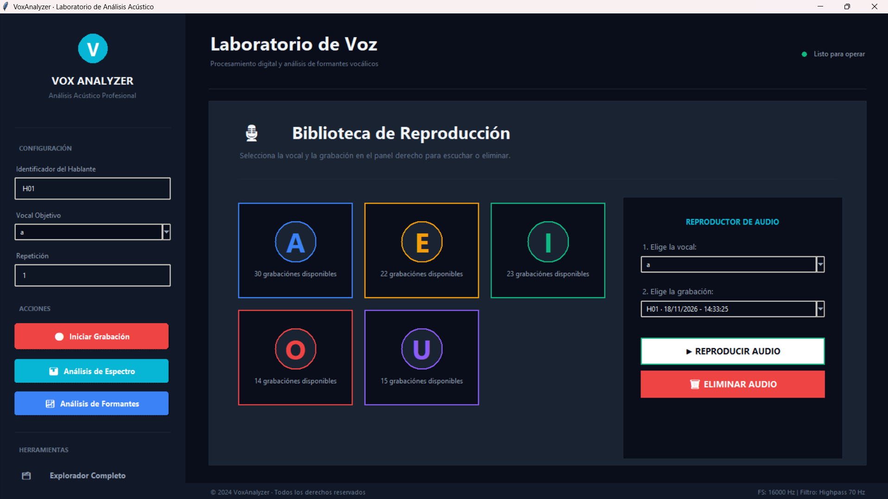
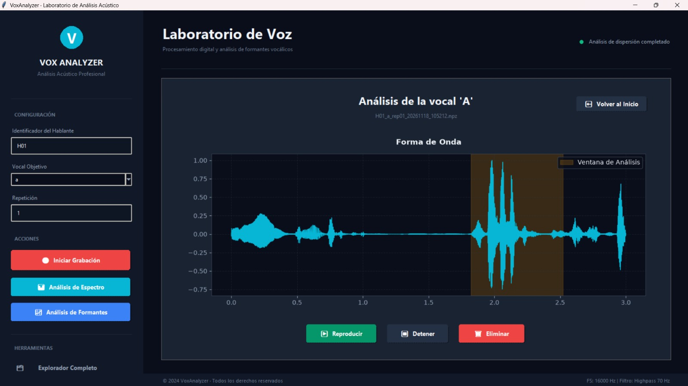
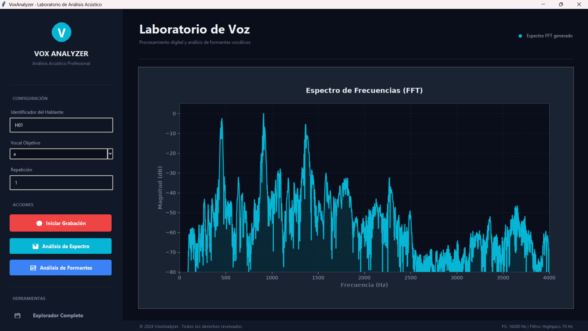
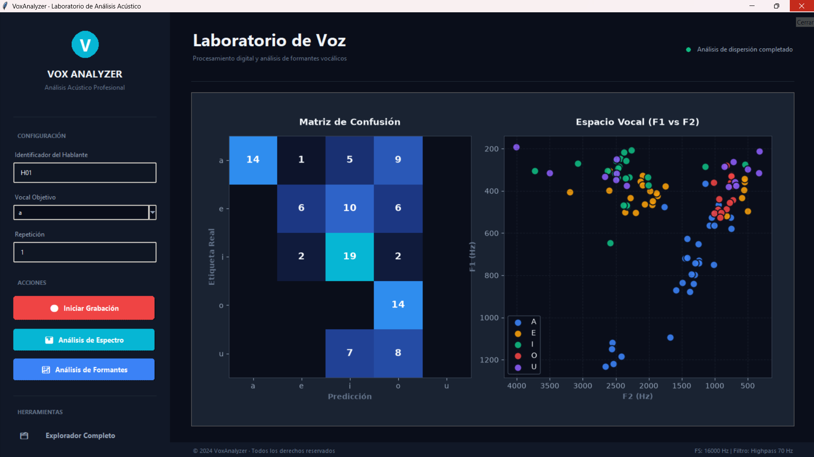
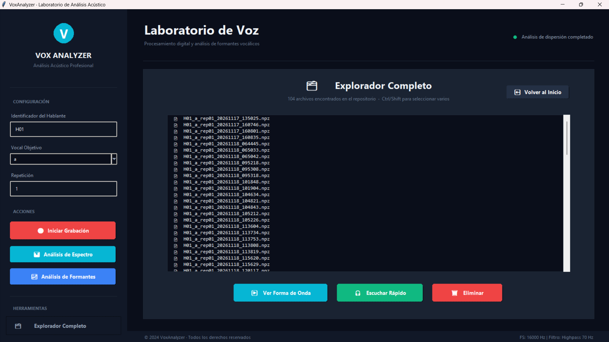

# VoxAnalyzer · Laboratorio de Análisis Acústico

Sistema de reconocimiento de vocales mediante captura de audio, procesamiento digital de señales, estimación de formantes LPC y clasificación.

Graba las vocales `a`, `e`, `i`, `o` y `u`, visualiza su forma de onda y su espectro, obtiene F1, F2 y F3, y clasifica la vocal pronunciada.

## Código

El código del proyecto está en [`vox_analyzer.py`](vox_analyzer.py): captura de audio a 16 kHz, preprocesamiento, detección del segmento de voz, espectro FFT, estimación de formantes LPC y la interfaz gráfica en Tkinter con modo oscuro.

## Pantalla principal



Biblioteca de reproducción con tarjetas por vocal y reproductor de audio. En la captura: H01, A: 30, E: 22, I: 23, O: 14, U: 15 grabaciones.

## Uso

### 1. Ver una grabación — forma de onda



Forma de onda de 3 segundos con la ventana de análisis marcada. Permite reproducir, detener y eliminar la grabación.

### 2. Visualizar un espectro



Espectro de frecuencias (FFT) de 0 a 4000 Hz, en dB, con ventana Hann.

### 3. Calcular formantes



Matriz de confusión y dispersión F1 vs F2. LPC de orden 16 sobre un frame de 30 ms, con F1, F2 y F3.

### 4. Gestión de grabaciones



Explorador completo del repositorio: 104 archivos `.npz` en la captura, con ver forma de onda, escuchar y eliminar.

## Características técnicas

- Frecuencia de muestreo: 16000 Hz
- Duración de captura: 3 s
- Filtro: Highpass Butterworth de orden 4, 70 Hz
- Ventana de análisis de voz: 0.70 s por energía RMS
- Frame LPC: 30 ms, ventana Hamming, orden 16
- Formantes válidos: 90–5000 Hz, ancho de banda ≤ 400 Hz
- Guardado: `capturas_vocales/*.npz` con formato `H01_a_rep01_20261118_105212.npz`
- Interfaz: Tkinter + Matplotlib, modo oscuro

## Requisitos

- Windows
- Python 3.10 o posterior
- Micrófono
- Dependencias: `numpy`, `scipy`, `matplotlib`, `sounddevice`, `tkinter`

## Instalación

```bash
py -m venv .venv
.\.venv\Scripts\Activate.ps1
python -m pip install --upgrade pip
python -m pip install -r requirements.txt
```

## Video demostrativo

[Ver video demostrativo en YouTube](https://youtu.be/i2H5qq3Z5gA?si=RfjLssIIA39kxYAq) — "Procesamiento digital de señales: Sistema de reconocimiento de vocales mediante captura de audio", 3:21 min, 1280×720.

Muestra la Biblioteca de Reproducción, la reproducción de una grabación, una grabación en vivo con resultado (vocal E y luego A, con aviso de vocal incorrecta), el espectro FFT y la matriz de confusión con el espacio vocal F1 vs F2.

## Estructura

```text
vox_analyzer.py           Código del sistema (captura, DSP, LPC, interfaz Tkinter)
requirements.txt          Dependencias de pip
images/                   Capturas de la interfaz en orden
```

**Docente**

Manuel Ruiz

**Integrantes del equipo**

- Ángel Humberto Alonzo Espinoza
- Raúl Cortina Solis
- Saul Alberto De la Cruz Maldonado
